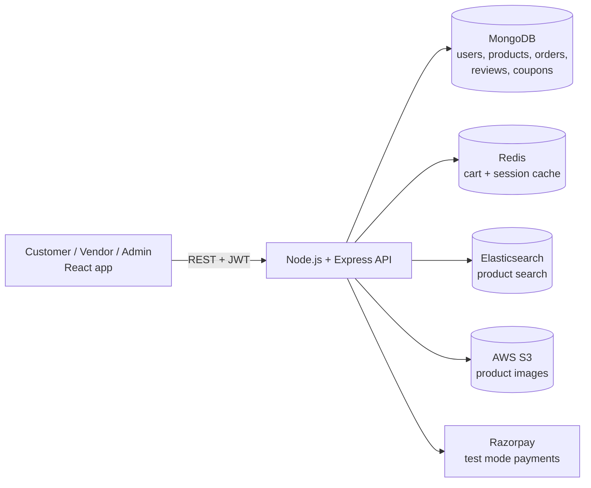

# FS-01 Architecture

## Roles
| Role | Can do |
|---|---|
| Customer | browse/search, cart, checkout, pay, track orders, download invoice, review purchased products |
| Vendor | register shop (needs admin approval), product CRUD + image upload, move own order items forward, see earnings |
| Admin | approve vendors, manage coupons, view analytics, reindex search |

## Database schema (MongoDB)
- **User**: name, email, password(hash), role, shopName, vendorStatus, razorpayAccountId
- **Product**: vendor→User, name, description, category, brand, price, stock, images[], ratingAvg, ratingCount
- **Order**: customer→User, items[{product, vendor, name, price, qty, net, commission, payout, status}], address, subtotal, discount, total, coupon, paymentStatus, paymentMode, razorpayOrderId, razorpayPaymentId, splits[{vendor, gross, commission, payout, transferStatus}], status
- **Review**: product→Product, user→User, rating(1-5), comment (unique per user+product)
- **Coupon**: code, type(percent|flat), value, minOrder, maxUses, used, expiresAt, active

## Key flows
1. **Auth**: bcrypt password hash, JWT (7d), `protect` + `allow(role)` middleware. Admin can never self-register.
2. **Search**: product writes are mirrored into Elasticsearch (fuzzy multi-match, filters, sort). If ES is down the API falls back to MongoDB text search automatically.
3. **Cart**: stored in Redis as `cart:<userId>` JSON (in-memory fallback when Redis is unavailable).
4. **Checkout**: validates stock, applies coupon, allocates discount proportionally, computes commission per item, creates order (payment pending) and a Razorpay order.
5. **Payment verify**: HMAC-SHA256 signature check, then stock deduction, coupon usage count, cart clear, vendor payout transfer (Razorpay Route when vendor has a linked account, otherwise recorded in the split ledger).
6. **Lifecycle**: placed → packed → shipped → delivered, one step at a time, per item (vendors only touch their own items). Order status = least advanced item.
7. **Invoice**: PDF generated on demand with pdfkit.
