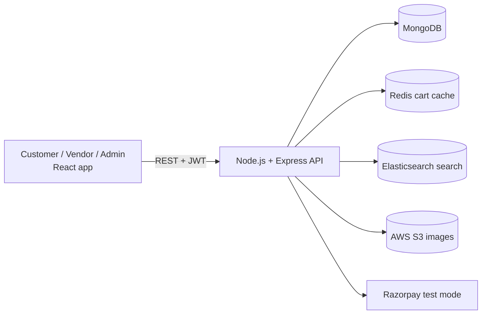
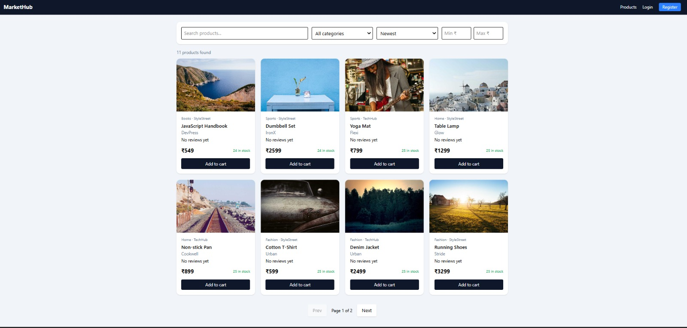
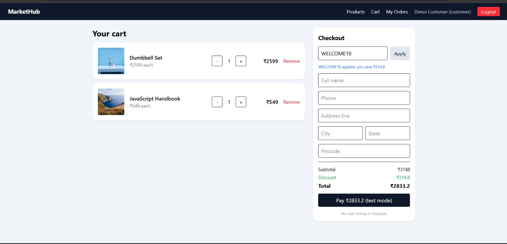
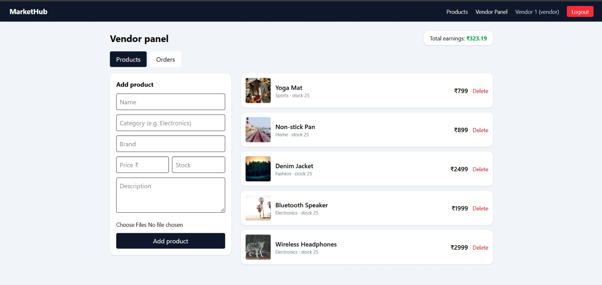
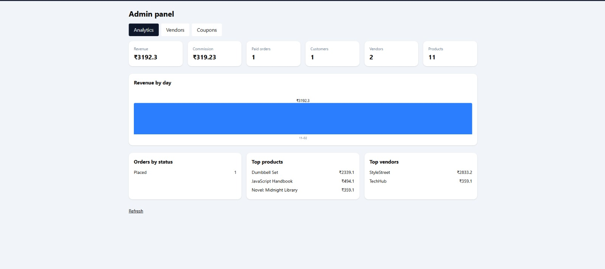
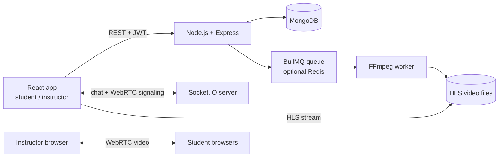
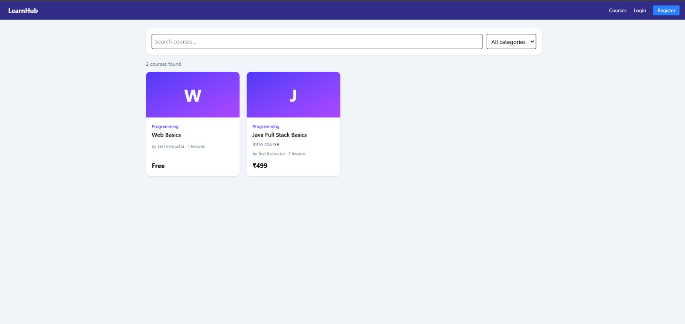
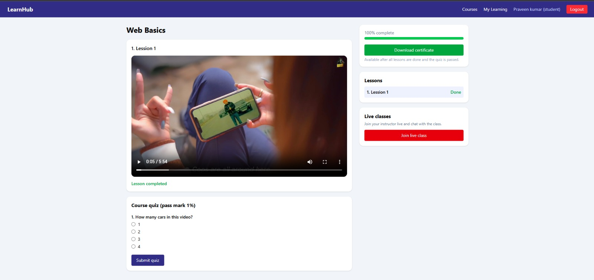
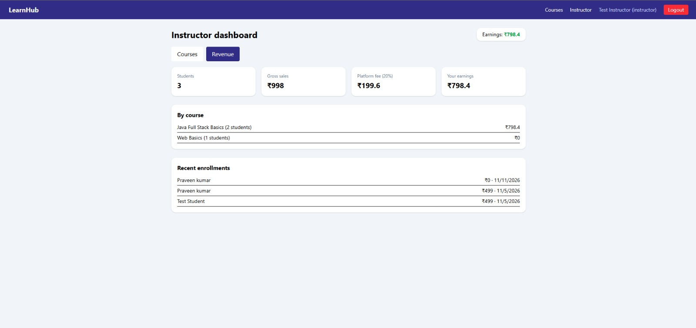
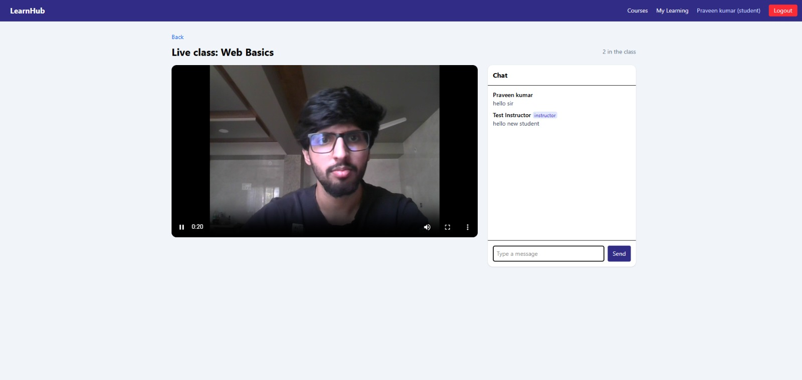

# Nexvia Capstone Projects

Praveen Kumar, Full Stack Development Intern, Nexvia Technologies

Two full-stack projects in one repository:

| Folder | Project | Stack |
|---|---|---|
| `FS-01` | Multi-Vendor E-Commerce Marketplace | React, Node.js, Express, MongoDB, Redis, Elasticsearch, AWS S3, Razorpay |
| `FS-03` | Learning Management System with Live Classes | React, Node.js, Express, MongoDB, BullMQ, FFmpeg, HLS, WebRTC, Socket.IO |

Demo videos (`FS-01DEMO.mp4` and `FS-03DEMO.mp4`): [Google Drive folder](https://drive.google.com/drive/folders/1Tg5JCko4ZVqoUbh346Sl8y9aCISBwE-K?usp=sharing)

## Requirements

Node.js 20 or newer, and a MongoDB database (free MongoDB Atlas cluster or a local MongoDB). Everything else is optional and falls back automatically.

---

# FS-01: Multi-Vendor E-Commerce Marketplace

An Amazon-style marketplace where vendors sell, customers buy, and the platform splits each payment and earns commission.

## Features

- Roles: customer, vendor, admin. JWT login with role-based access control.
- Vendor onboarding with admin approval. Product create, edit, delete with image upload.
- Product search with filters (category, price range) and sorting, using Elasticsearch with an automatic MongoDB text-search fallback.
- Cart stored in Redis (in-memory fallback), checkout, and an order lifecycle: placed, packed, shipped, delivered, updated per item by each vendor.
- Payments: Razorpay order creation and signature verification, discount allocation per item, platform commission (10% by default) and vendor payout split recorded per order. A built-in mock payment mode is used when no Razorpay keys are set.
- Reviews (verified buyers only), coupons (percent or flat, minimum order, usage limits), PDF invoices.
- Admin: vendor approval, coupon management, analytics page (revenue, commission, orders by day and status, top products, top vendors).

## Architecture



More detail: [`FS-01/docs/ARCHITECTURE.md`](FS-01/docs/ARCHITECTURE.md) (schema and flows) and [`FS-01/docs/API.md`](FS-01/docs/API.md) (all endpoints).

## Run locally

```bash
cd FS-01/backend
cp .env.example .env        # set MONGO_URI and JWT_SECRET
npm install
npm run seed                # demo users, 12 products, 2 coupons
npm run dev                 # API on http://localhost:5000

cd ../frontend
# create .env containing: VITE_API_URL=http://localhost:5000/api
npm install
npm run dev                 # app on http://localhost:5173
```

Optional services: `docker compose up -d` (in `FS-01`) starts MongoDB, Redis and Elasticsearch.

Demo logins after seeding: `admin@demo.com / Admin@123`, `vendor1@demo.com / Vendor@123`, `customer@demo.com / Customer@123`. Coupons: `WELCOME10`, `FLAT200`.

## Tests

`cd FS-01/backend && npm test` runs 13 automated tests (commission split, coupon rules, auth guards). Results: [`FS-01/docs/test-results.txt`](FS-01/docs/test-results.txt).

## Screenshots






---

# FS-03: Learning Management System with Live Classes

A complete online school: courses, video lessons, live classes, quizzes, certificates and instructor earnings.

## Features

- Roles: student and instructor, JWT login.
- Course catalog with search and category filter. Instructors create courses, add lessons, and publish.
- Video upload: files are converted with FFmpeg to HLS streaming format in a background job (BullMQ queue when `REDIS_URL` is set, direct background conversion otherwise) and played in the browser with hls.js. Video links are hidden from students who are not enrolled.
- Enrollment with a test-mode payment screen (no real money moves).
- Progress tracking per lesson, quizzes with automatic grading and a pass mark.
- PDF certificate generated on completion (all lessons done and quiz passed).
- Instructor revenue dashboard: gross sales, platform fee (20% by default), earnings, per course and recent enrollments.
- Live classes: the instructor goes live with a camera or screen share, enrolled students watch over WebRTC and chat in real time. Socket.IO handles signaling and chat.

## Architecture



## Data model

User (name, email, role), Course (instructor, lessons[ title, videoUrl, videoStatus ], price, published), Enrollment (student, course, paid, completedLessons, progress), Quiz (course, questions, passMark), QuizAttempt (student, score, passed).

## API summary (base `http://localhost:5001/api`)

| Method | Path | Who | Purpose |
|---|---|---|---|
| POST | /auth/register, /auth/login | public | accounts |
| GET | /courses | public | published courses, `?q=&category=` |
| GET | /courses/:id | any | detail, video links only for enrolled or owner |
| POST/PUT | /courses, /courses/:id | instructor | create, edit, publish |
| POST | /courses/:id/lessons | instructor | add lesson |
| POST | /courses/:id/lessons/:lessonId/video | instructor | upload, converts to HLS |
| POST | /courses/:id/enroll | student | enroll (test payment) |
| POST | /courses/:id/lessons/:lessonId/complete | student | mark lesson done |
| PUT/GET | /courses/:id/quiz | instructor / enrolled | create quiz, read quiz |
| POST | /courses/:id/quiz/submit | student | automatic grading |
| GET | /courses/:id/certificate | student | PDF certificate |
| GET | /instructor/revenue | instructor | earnings dashboard |
| Socket | join-class, signal, chat | enrolled or owner | live class |

## Run locally

```bash
cd FS-03/backend
cp .env.example .env        # set MONGO_URI (use database name lms) and JWT_SECRET
npm install
npm run dev                 # API on http://localhost:5001

cd ../frontend
# create .env containing:
#   VITE_API_URL=http://localhost:5001/api
#   VITE_SOCKET_URL=http://localhost:5001
npm install
npm run dev                 # app on http://localhost:5174
```

There is no seed script: register an instructor and a student from the Register page. Live class test: open the instructor in one browser window and the student in an incognito window.

## Tests

`FS-03/backend/scripts/live-test.js` is an integration check for the live class server (join, signaling, chat, bad token, class end). Results: [`FS-03/docs/test-results.txt`](FS-03/docs/test-results.txt). It uses local test accounts, so edit the course id inside the script to run it on your own data.

## Screenshots






---

# Known limitations (honest notes)

- Not deployed: both projects were demonstrated locally with screen-recorded demos.
- FS-01: Razorpay order creation, signature verification and Route transfers are implemented in the API, but the browser checkout popup is not wired, so the demo uses the built-in mock payment mode.
- FS-03: videos are served by the API server from `/media/hls`. AWS CloudFront delivery was not set up. State is managed with React Context, not Redux Toolkit. Enrollment payment is a test-mode screen.
- Seed images in FS-01 are random placeholder photos.

Individual reflection: [`REFLECTION.md`](REFLECTION.md)